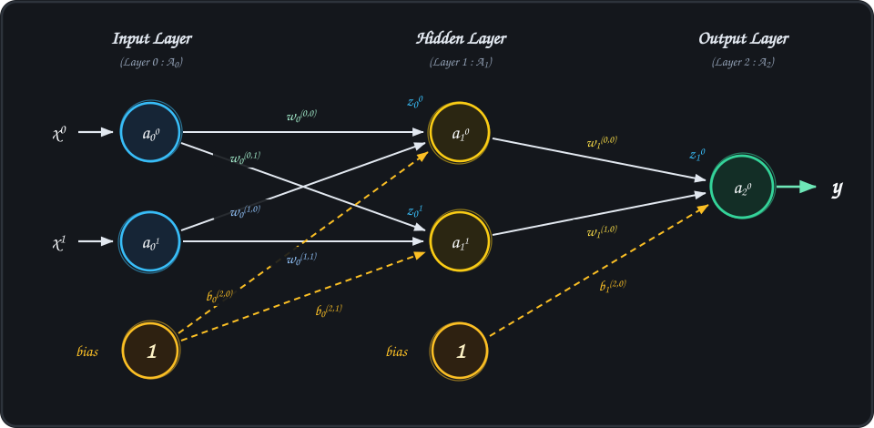

# XOR Neural Network from Scratch in C++

A zero-dependency, lightweight neural network built from scratch in pure C++ to solve the non-linear XOR problem. This codebase implements a custom header-only row-major `Matrix` engine, forward propagation with Sigmoid activations, Sum of Squared Errors (SSE) loss, and training via **numerical gradients (finite differences)** and gradient descent.



---

## 1. Why XOR?

| $x_0$ | $x_1$ | $y$ (XOR) |
| :---: | :---: | :---: |
| $0$ | $0$ | $0$ |
| $0$ | $1$ | $1$ |
| $1$ | $0$ | $1$ |
| $1$ | $1$ | $0$ |

XOR is **not linearly separable**—no single straight line can separate the `1`s from the `0`s on a 2D graph. Solving it requires at least **one hidden layer** with a **non-linear activation** so the network can combine multiple lines into a non-linear boundary.

---

## 2. Why Each Component Exists

### Why Do We Need a Bias Neuron (`1`)?
Without a bias, a neuron computes $z = w_0 x_0 + w_1 x_1$. For input $(0, 0)$, $z$ is always $0$ ($\sigma(0) = 0.5$), no matter how much you train the weights.

* **As a threshold:** Adding a bias ($z = w_0 x_0 + w_1 x_1 + b$) lets the neuron shift its sum up or down so it can cleanly turn ON ($z > 0$) or OFF ($z < 0$).
* **As a line shift:** At the decision boundary $z = 0$, we get $x_1 = \left(-\frac{w_0}{w_1}\right)x_0 + \left(-\frac{b}{w_1}\right)$. Weights control the **slope**, while bias controls the **y-intercept**. Without bias ($b = 0$), every line is pinned to $(0, 0)$ and can only spin—never slide across the grid.
* **Why put `1` in the matrix?** The `1` is just a multiplier. The actual learnable bias values live in the **bottom row** of $W_0$ and $W_1$. During matrix multiplication, $1 \cdot b = b$, so gradient descent learns biases automatically alongside the weights.

### Why Initialize Weights in $[-1, 1]$?
Sigmoid bounds the **output** to $(0, 1)$, not the input $z = A \cdot W$. Its derivative is $\sigma'(z) = \sigma(z)(1 - \sigma(z))$:
* Near $z \approx 0$, the slope is steepest ($\sigma'(0) = 0.25$) and learning is fast.
* For large $|z|$ (e.g., $z = 10$), Sigmoid flattens out ($\sigma'(10) \approx 0.00005$) and learning stalls (**saturation**).

Randomizing weights in $[-1, 1]$ keeps $z$ near $0$, gives both positive and negative weights, and **breaks symmetry** (if all weights started at `0`, every hidden neuron would learn the exact same thing).

### Why Use Sigmoid?
Stacking linear layers without an activation collapses into a single linear layer: $(A_0 W_0) W_1 = A_0 (W_0 W_1)$, which still cannot solve XOR. Sigmoid:

$$\sigma(x) = \frac{1}{1 + e^{-x}}$$

adds smooth **non-linearity** between layers and squashes the final output into $(0, 1)$ to match binary XOR targets.

---

## 3. Forward Pass Equations & Matrix Proof

Architecture: **$3 \times 3 \times 1$** (2 inputs + 1 bias $\rightarrow$ 2 hidden + 1 bias $\rightarrow$ 1 output).

### Scalar Equations (One Sample)

**Hidden Layer:**
$$z_{0,0} = a_0^0 w_0^{(0,0)} + a_0^1 w_0^{(1,0)} + 1 \cdot b_0^{(2,0)}$$
$$z_{0,1} = a_0^0 w_0^{(0,1)} + a_0^1 w_0^{(1,1)} + 1 \cdot b_0^{(2,1)}$$
$$a_1^0 = \sigma(z_{0,0}), \qquad a_1^1 = \sigma(z_{0,1}), \qquad a_1^2 = 1$$

**Output Layer:**
$$z_{1,0} = a_1^0 w_1^{(0,0)} + a_1^1 w_1^{(1,0)} + 1 \cdot b_1^{(2,0)}$$
$$a_2^0 = \sigma(z_{1,0}) = y$$

### Matrix Proof ($Z = A \cdot W$)
Stacking all 4 XOR inputs as **rows** in $A_0$ and placing biases in the **last row** of $W_0$ and $W_1$ computes all 4 samples in one multiplication:

**Layer 0 $\rightarrow$ Layer 1 ($A_0 \cdot W_0 = Z_0$):**
$$
\underbrace{\begin{bmatrix} 0 & 0 & 1 \\ 0 & 1 & 1 \\ 1 & 0 & 1 \\ 1 & 1 & 1 \end{bmatrix}}_{A_0\;(4 \times 3)}
\cdot
\underbrace{\begin{bmatrix} w_0^{(0,0)} & w_0^{(0,1)} \\ w_0^{(1,0)} & w_0^{(1,1)} \\ b_0^{(2,0)} & b_0^{(2,1)} \end{bmatrix}}_{W_0\;(3 \times 2)}
=
\underbrace{\begin{bmatrix} z_{0,0}^{(0)} & z_{0,1}^{(0)} \\ z_{0,0}^{(1)} & z_{0,1}^{(1)} \\ z_{0,0}^{(2)} & z_{0,1}^{(2)} \\ z_{0,0}^{(3)} & z_{0,1}^{(3)} \end{bmatrix}}_{Z_0\;(4 \times 2)}
$$

Applying $\sigma(Z_0)$ fills the first two columns of $A_1$, while column 2 stays `1`.

**Layer 1 $\rightarrow$ Layer 2 ($A_1 \cdot W_1 = Z_1$):**
$$
\underbrace{\begin{bmatrix} a_1^{0(0)} & a_1^{1(0)} & 1 \\ a_1^{0(1)} & a_1^{1(1)} & 1 \\ a_1^{0(2)} & a_1^{1(2)} & 1 \\ a_1^{0(3)} & a_1^{1(3)} & 1 \end{bmatrix}}_{A_1\;(4 \times 3)}
\cdot
\underbrace{\begin{bmatrix} w_1^{(0,0)} \\ w_1^{(1,0)} \\ b_1^{(2,0)} \end{bmatrix}}_{W_1\;(3 \times 1)}
=
\underbrace{\begin{bmatrix} z_{1,0}^{(0)} \\ z_{1,0}^{(1)} \\ z_{1,0}^{(2)} \\ z_{1,0}^{(3)} \end{bmatrix}}_{Z_1\;(4 \times 1)}
$$

Finally, $A_2 = \sigma(Z_1)$ gives the $4 \times 1$ output predictions $y$.

---

## 4. Loss & Training Math

### Sum of Squared Errors (SSE)
Measures how far the predictions $A_2$ are from the true XOR labels $y_{\text{target}}$:

$$L = \sum_{i=0}^{3} \left(A_2(i, 0) - y_{\text{target}}(i, 0)\right)^2$$

Squaring keeps all errors positive and penalizes larger mistakes more heavily.

### Numerical Gradients (Finite Differences)
To find how each weight affects the loss without deriving backpropagation yet, we use the definition of a derivative with a tiny step $\epsilon = 10^{-4}$:

$$\frac{\partial L}{\partial w} \approx \frac{L(w + \epsilon) - L(w)}{\epsilon}$$

For each of the 9 parameters ($6$ in $W_0$, $3$ in $W_1$), we nudge the weight by $+\epsilon$, recompute the loss, record the slope in $dW$, and restore the weight. This is slower than backpropagation for large networks, but it is simple, bug-proof, and serves as a **gradient checker** for backpropagation later.

### Gradient Descent
Each weight moves opposite to its slope to reduce the loss, scaled by learning rate $\alpha = 10^{-2}$:

$$W_0 \leftarrow W_0 - \alpha \, dW_0, \qquad W_1 \leftarrow W_1 - \alpha \, dW_1$$

---

## 5. Key C++ Implementation Details

* **Zero External Dependencies:** Built purely with the C++ Standard Library (`<vector>`, `<random>`, `<cmath>`).
* **Header-Only Architecture:** Drop-in `matrix.hpp` and `functions.hpp` headers—only `xor_nn.cpp` needs to be compiled.
* **Flat Row-Major Memory (`matrix.hpp`):** All $r \times c$ floats live in one contiguous `std::vector<float>` indexed via `arr[r * cols + c]` for cache efficiency and automatic memory management.
* **Decoupled Function Pointers:** `matrix_activation` accepts a generic `float (*activation_func)(float)` pointer, so `matrix.hpp` stays completely independent of `functions.hpp`.
* **Integrated Bias Handling:** Uses a constant `1.0f` bias column padded directly into the activation matrices ($A_0$ and $A_1$), allowing biases to be learned seamlessly as the final row of each weight matrix ($W_0$ and $W_1$).
* **Bias-Preserving Operations:** `A0` and `A1` are initialized to `1.0f`. Because `matrix_copy` and `matrix_activation` loop only over the source dimensions ($4 \times 2$), they update the data/activation columns while leaving the rightmost bias column permanently at `1.0f`.
* **Numerical Gradient Verification:** Computes weight gradients element-by-element using finite differences to validate convergence before transitioning to analytical backpropagation.

---

## How Training Works (Pre-Backpropagation)

1. **Forward Pass:** Computes $Z_0 = A_0 W_0$, $A_1 = \sigma(Z_0)$ (preserving the bias column), $Z_1 = A_1 W_1$, and $A_2 = \sigma(Z_1)$, where:
   $$\sigma(x) = \frac{1}{1 + e^{-x}}$$
2. **Loss Calculation:** Evaluates predictions against XOR targets using Sum of Squared Errors (SSE):
   $$L = \sum_{i=1}^{N} (A_{2,i} - y_i)^2$$
3. **Numerical Gradients:** Perturbs each weight in $W_0$ and $W_1$ by $\epsilon = 10^{-4}$ to approximate the partial derivative:
   $$\frac{\partial L}{\partial w} \approx \frac{L(w + \epsilon) - L(w)}{\epsilon}$$
4. **Gradient Descent:** Updates all weights simultaneously with learning rate $\alpha = 10^{-2}$:
   $$w \leftarrow w - \alpha \frac{\partial L}{\partial w}$$

---

## Build & Run

Compile with any C++17 (or newer) compiler. Adding `-O2` is recommended for faster execution over 100,000 epochs:

```bash
g++ -O2 -std=c++17 xor_nn.cpp -o xor_nn
./xor_nn
```

*(On Windows with MinGW, run `xor_nn.exe`.)*